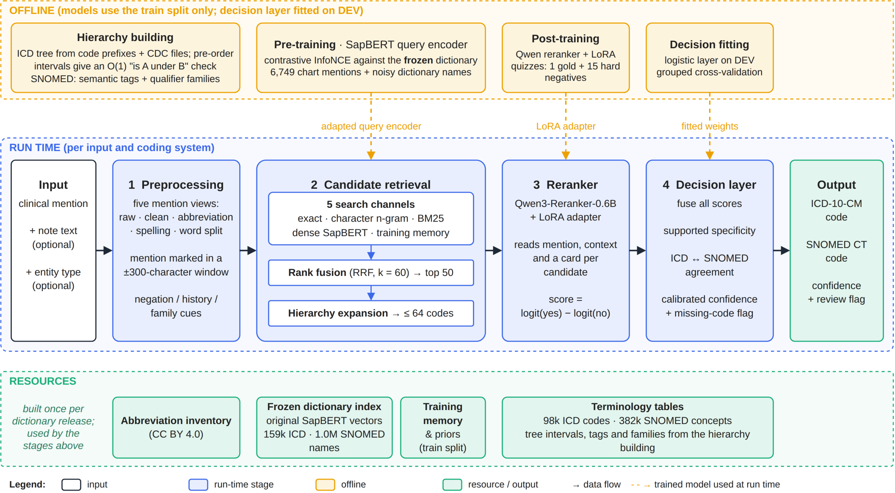
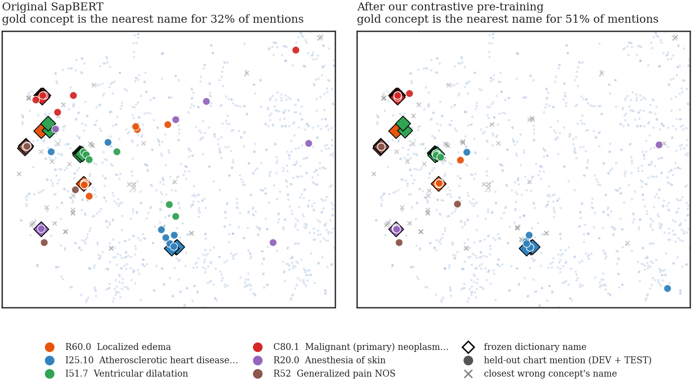
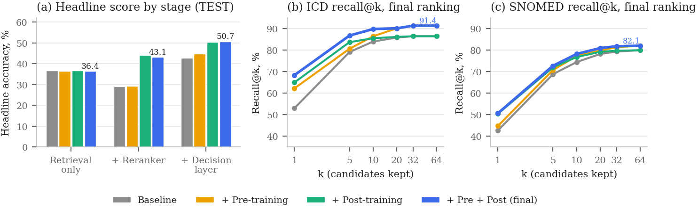
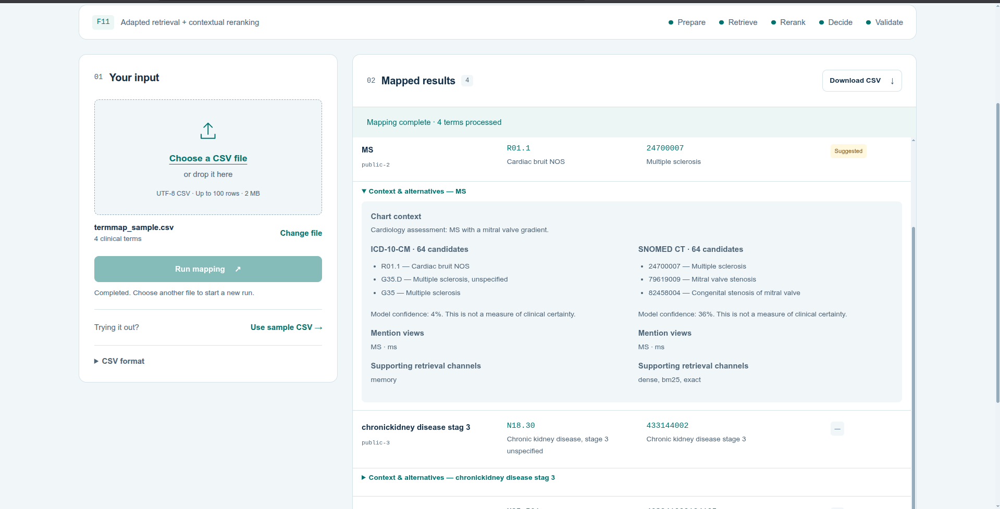

# TermMap: Mapping Clinical Mentions to ICD-10-CM and SNOMED CT

**Team HackLabs**, Indian Institute of Technology Roorkee: Garv Shailesh Agarwal, Pratham Singla, Adesh Gupta

| Resource | Link |
|---|---|
| Report (PDF) | [HackLabs_report.pdf](HackLabs_report.pdf) |
| GitHub repository | [github.com/kingslayer35/HackLabs_IITR](https://github.com/kingslayer35/HackLabs_IITR) |
| Google Drive: private assets and demo video | [Drive folder](https://drive.google.com/drive/folders/15025axFNbaNf2f8Tkd-XEGYgZrOe5GyQ?usp=sharing) (restricted access) |
| SapBERT ICD query encoder | [yobro4619/termmap-sapbert-icd](https://huggingface.co/yobro4619/termmap-sapbert-icd) |
| SapBERT SNOMED query encoder | [yobro4619/termmap-sapbert-snomed](https://huggingface.co/yobro4619/termmap-sapbert-snomed) |
| Qwen reranker LoRA, epoch 2 (used) | [yobro4619/termmap-qwen-lora-epoch2](https://huggingface.co/yobro4619/termmap-qwen-lora-epoch2) |
| Qwen reranker LoRA, epoch 1 | [yobro4619/termmap-qwen-lora-epoch1](https://huggingface.co/yobro4619/termmap-qwen-lora-epoch1) |

The Drive folder holds the private artifact bundle and the demo video. The bundle contains the training datasets, terminology tables, base and trained models, frozen decision layers and validated predictions. Extract it at the repository root to restore `private_assets/`. It is shared only with the challenge team and judges. The Hugging Face repositories contain model weights only, never clinical text. Both LoRA adapters load on top of `Qwen/Qwen3-Reranker-0.6B`.

## Contents

1. [What TermMap does](#what-termmap-does)
2. [Architecture](#architecture)
3. [Results](#results)
4. [How pre-training changed the embedding space](#how-pre-training-changed-the-embedding-space)
5. [Demo](#demo)
6. [Alternative solution: agentic retrieval](#alternative-solution-agentic-retrieval)
7. [Repository layout](#repository-layout)
8. [How to run](#how-to-run)

## What TermMap does

Give TermMap a clinical mention, such as "HTN" or "chronickidney dis stg 3", with the note text around it. It returns one ICD-10-CM code and one SNOMED CT US code. Each system is scored by exact match, and the headline score is the lower of the two accuracies.

Half of the SNOMED codes in our held-out data never appear in training, so TermMap does not classify into a fixed label set. It searches the whole dictionary (98k ICD codes, 382k SNOMED concepts), lets a context-aware model choose among the best candidates, and then applies coding rules. Everything runs locally; no chart text is sent to an external service.

## Architecture



| Stage | What it does | Model or resource |
|---|---|---|
| 1. Preprocessing | Builds five versions of the mention (raw, cleaned, abbreviation reading, spelling fix, word split). Marks the mention in a ±300-character window and flags negation, history and family cues. Numbers, laterality and stage are never edited. | Rules, Clinical Abbreviation Meta-Inventory |
| 2. Candidate retrieval | Exact, character n-gram, BM25, dense and training-memory search, merged by rank fusion and widened with hierarchy siblings to at most 64 candidates | SapBERT: original dictionary vectors, adapted query encoder |
| 3. Reranker | Reads the mention, its context and a description card for each candidate, and scores every candidate | Qwen3-Reranker-0.6B with a LoRA adapter |
| 4. Decision layer | Combines all scores, moves to a more specific code only when the text supports it, adds a soft ICD–SNOMED agreement and outputs a calibrated confidence and review flag | Small logistic models fitted on DEV |

Two models are trained offline:

- **Pre-training (contrastive).** The SapBERT query encoder learns to place a chart mention next to its gold concept and away from every other concept in the dictionary. The dictionary vectors stay frozen, so codes never seen in training keep their original vectors.
- **Post-training (LoRA).** The Qwen reranker trains on quizzes of one gold code and 15 hard negatives taken from our own retriever. LoRA updates 1.7% of its weights.

The ICD hierarchy is rebuilt from code prefixes and the CDC FY2026 files. Each code gets a pre-order interval, so "is code A under code B" is an O(1) check.

## Results

Data is split by note: train 6,751 rows (70.0%), DEV 1,368 (14.2%) and internal TEST 1,527 (15.8%). Both models train on train only. Decision layers are fitted on DEV and frozen before TEST is scored once. TEST is our own held-out split, not the organisers' hidden set.

Baseline is the full pipeline with the original, untrained SapBERT and Qwen. Accuracy is exact-code match in %, with 95% grouped-bootstrap intervals for the headline.

| Set | Pipeline | ICD | SNOMED (all types) | SNOMED diagnoses | Headline (lower of ICD / SNOMED) |
|---|---|---|---|---|---|
| DEV | Baseline | 52.91 | 43.13 | 51.81 | 43.13 [40.18, 46.19] |
| DEV | + Pre-training | 56.88 | 45.24 | 52.59 | 45.24 [41.96, 48.26] |
| DEV | + Post-training | 60.86 | 50.53 | **57.77** | 50.53 [47.60, 53.70] |
| DEV | **+ Pre + Post (final)** | **66.97** | **51.30** | 57.25 | **51.30** [48.12, 54.47] |
| TEST | Baseline | 53.07 | 42.71 | 51.54 | 42.71 [39.91, 45.73] |
| TEST | + Pre-training | 62.27 | 44.80 | 55.13 | 44.80 [42.03, 47.91] |
| TEST | + Post-training | 65.03 | 50.46 | 61.54 | 50.46 [47.58, 53.32] |
| TEST | **+ Pre + Post (final)** | **68.40** | **50.71** | **62.05** | **50.71** [48.12, 53.57] |

On TEST the final system improves the headline by **+7.99 points** over the baseline (paired 95% interval 5.61 to 10.37) and ICD by +15.34. The challenge target of 95% is not met.

**Long tail** (TEST, final accuracy % by how often the gold code appears in training):

| Pipeline | ICD unseen | ICD rare (1–5) | ICD common (>5) | SNOMED unseen | SNOMED rare | SNOMED common |
|---|---|---|---|---|---|---|
| Baseline | 42.9 | 57.1 | 54.8 | 29.3 | 55.7 | 65.1 |
| + Post-training | 57.1 | 67.3 | 67.7 | 39.5 | 60.9 | 69.8 |
| **+ Pre + Post (final)** | **57.1** | **73.7** | **68.8** | 38.5 | **63.2** | 67.4 |

On held-out dictionary names (codes whose names were hidden from training and indexes), the final system reaches **67.0% ICD and 77.2% SNOMED**, up from 15.1% and 51.6%.

**Recall.** Pre-training raises the share of inputs whose gold code is among the 64 retrieved candidates (TEST ICD 86.2% → 91.4%, SNOMED 80.0% → 82.1%). After the reranker and decision layer, the gold is in the top 10 for 89.9% of ICD and 78.3% of SNOMED inputs. Most remaining SNOMED errors are choosing the wrong code from a list that already contains the right one.

**Speed.** On one RTX A6000 the final system takes a median 1.57 s per input for both systems, including output validation (p95 1.97 s).

The report has every table, the stage-by-stage ablation, the error analysis and the latency breakdown. Raw numbers are in [results/](results/README.md).

## How pre-training changed the embedding space



Both panels show the same map of frozen dictionary names. Diamonds are the names of six ICD concepts, and circles are held-out DEV and TEST chart mentions of those concepts. With the original encoder (left) the mentions are scattered and often sit next to wrong concepts. After contrastive pre-training (right) most of them land on their own concept. Over all 651 held-out ICD mentions, the gold concept is the nearest dictionary name for 32% of mentions before pre-training and 51% after.



How accuracy changes along the pipeline on TEST. (a) Headline accuracy after retrieval, after the reranker and after the decision layer, for all four pipelines. The untrained reranker lowers accuracy; the post-trained one raises it. (b, c) Recall@k of the final ranking for ICD and SNOMED.

## Demo



We host TermMap locally as a small web app. Upload a CSV of mentions (with optional note text), press **Run mapping**, and get both codes for every row with their descriptions. Each row also shows the top alternative candidates, the mention views, which retrieval channels found the code, a model confidence and a review suggestion for uncertain rows. The results download as the required four-column CSV. The app calls the same released pipeline as `run.sh`; nothing is hard-coded. A walkthrough video is in the Drive folder, and setup details are in [demo/README.md](demo/README.md).

## Alternative solution: agentic retrieval

We also built and evaluated a separate approach: a tool-using LLM agent that works like a coder. It searches the dictionaries, reads code descriptions and ICD parents and children, looks at similar training mentions and then commits to a validated code. It is not part of the submitted engine.

| Configuration (500 diagnosis inputs) | ICD | SNOMED | Both correct |
|---|---|---|---|
| Original search and inspection agent | 67.4 | 70.4 | 53.2 |
| SapBERT search for ICD | 69.2 | 69.2 | 53.0 |
| **With fallback rescue when the turn budget runs out** | **70.6** | **71.4** | **53.6** |

It reaches about 60% on unseen codes in both systems. The 500 inputs are reused development cases (diagnoses only), so these numbers are not directly comparable with the TEST results above. The agent needs several hosted LLM calls per input and is not deterministic. On its own it is therefore a second opinion, not a replacement. Next we plan to combine the two: for the hardest, low-confidence cases, an agentic loop will call our retrieval engine as a tool after reranking to re-check the final code and raise confidence in it. Details are in Appendix H of the report and in [agentic_solution/](agentic_solution/README.md).

## Repository layout

| Folder | Contents |
|---|---|
| [termmap/](termmap) | Pipeline source: [preprocessing](termmap/preprocessing/README.md), [terminology and hierarchy](termmap/terminology/README.md), [retrieval](termmap/retrieval/README.md), [pre-training](termmap/pretraining/README.md), [post-training](termmap/posttraining/README.md), [reranking](termmap/reranking/README.md), [decision layer](termmap/decision/README.md), [evaluation](termmap/evaluation/README.md) |
| [scripts/](scripts/README.md) | Command-line entry points for each stage |
| [configs/](configs) | Paths and frozen settings (`default.yaml`, plus pre- and post-training configs) |
| [results/](results/README.md) | Final DEV and TEST metrics, long-tail, probe, latency and complexity tables |
| [demo/](demo/README.md) | Local web app for CSV upload and mapping |
| [agentic_solution/](agentic_solution/README.md) | The alternative agent and its experiments |
| [docs/](docs) | Architecture, reproducibility, checkpoints, edge cases and resources |
| [tests/](tests) | Regression and integration tests |

## How to run

You need Python 3.11, an NVIDIA GPU with CUDA 12.8 (we used an RTX A6000, 48 GB), and the private bundle from the Drive folder. No API key is needed. Run the commands in this order from the repository root:

```bash
# 1. Get the code
git clone https://github.com/kingslayer35/HackLabs_IITR.git
cd HackLabs_IITR

# 2. Download the private artifact ZIP from the Drive folder, check it, and extract it here.
#    This restores private_assets/ (data, terminology tables, models, frozen decision layers).
sha256sum HackLabs_IITR_private_artifacts.zip   # must equal ea3d2590050a4fdf0fdb72280d0e42700ed0920f9411b72c83570062f2bea420
unzip HackLabs_IITR_private_artifacts.zip -d .

# 3. Main environment
python3.11 -m venv .venv && source .venv/bin/activate
pip install torch==2.8.0+cu128 --index-url https://download.pytorch.org/whl/cu128
pip install -r requirements.txt
pip install --no-deps -e .
python -m pytest -q                              # synthetic and integration tests

# 4. Separate environment for the vLLM reranker server (used by the final pipeline)
python3.11 -m venv .venv-vllm
.venv-vllm/bin/pip install -r requirements-vllm.lock

# 5. Rebuild the search indexes on a GPU (one time, no training)
python -m scripts.retrieval.build_indexes --smoke   # quick check
python -m scripts.retrieval.build_indexes

# 6. Map a file: input CSV with chunk_id, clinical_entity (chunk_text and subconcept optional)
bash run.sh /absolute/path/input.csv /absolute/path/predictions.csv
#    Output, in input order: chunk_id, clinical_entity, icd10cm_code, snomed_code
#    run.sh requests a GPU through Slurm; on a machine that already has a GPU, run instead:
#    python -m scripts.inference.predict /absolute/path/input.csv /absolute/path/predictions.csv

# 7. Optional: start the local demo, then open http://localhost:8787
bash demo/scripts/start.sh
```

Notes:

- Seeds are fixed (13) and scoring is deterministic, so the same input gives the same output.
- `configs/default.yaml` holds every path and setting. Set `TERMMAP_CONFIG` to use another config file.
- The demo needs a GPU worker next to the web server; see [demo/README.md](demo/README.md).
- To retrain the models, follow [docs/REPRODUCIBILITY.md](docs/REPRODUCIBILITY.md). The released checkpoints need no retraining.
